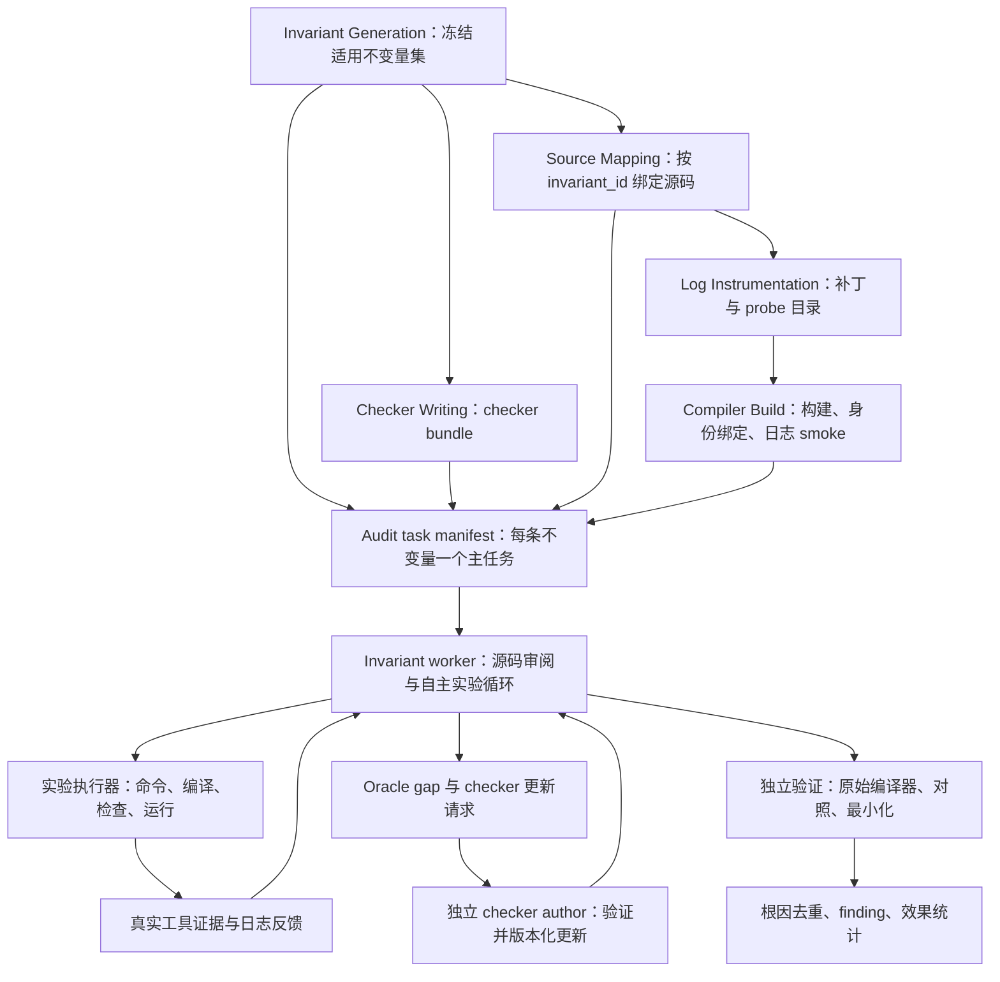

# DeFuzz 逐不变量审计与结果导向改造方案

日期：2026-10-14。状态：待实现的完整设计与实施契约。

本文面向实施 agent，包含本次讨论形成的理解、现有问题、目标结构、接口要求、代码落点和验收方法。所有改动共同构成一次完整改造；本文不定义排期、分期交付或仅完成部分功能的 MVP。

**目标：在相同编译器、源码范围、模型和资源预算下，通过不变量、源码映射、日志反馈与自主实验闭环，发现比 free agent 端到端审计更多的独立、可复现的真实编译器 bug。** 是否达到这个目标必须由对照实验判断，不能由中间产物数量或流水线正常退出代替。

本文包含 evaluator 的事后诊断与旧案例信息，只供开发和评估使用。实施 agent 可以读取本文；正式实验 worker 不得自动加载本文、诊断目录或旧 findings。worker 的方法变更必须落实到显式阶段定义与冻结配置。

## 1. 最新理解与已确定的设计决定

### 1.1 每条不变量都是独立审计对象

审计任务按 `invariant_id` 建立，不再按 A–E family 分组。每条适用不变量都有独立输入、探索状态、实验记录、预算记录和结果；worker 的推理上下文不混入一整组机制的全部任务。

family 原本用于组织机制和分工，但固定分类已经成为漏检来源。机制标签可以继续用于检索和结果展示，不得决定一条已选不变量有没有 worker。未知但结构合法的机制标签也要形成任务。任务并发数是资源配置，与 family 数量无关。

一个任务可以包含多种语言、多个编译选项和多个必需 ISA 的实验，不必把“不变量 × ISA × 选项”全部拆成互不关联的 worker。跨 ISA 差分必须在同一任务中保留对照关系。

### 1.2 Checker catalog 是工具能力目录

checker 是根据编译结果、IR、汇编、ELF 或测试进程行为，检查特定不变量的可执行验证器。catalog 是这些 checker 的目录，包含 checker ID、对应不变量、适用 ISA、所需输入和执行方式。

catalog 不等于审计任务列表，也不能代表所有可能缺陷的范围。worker 可以发现现有 checker 未覆盖的问题。没有匹配 checker 时，应继续生成测试、观察行为并提出 `oracle_gap`，不能要求先写出完整 finding 才获得验证能力。

完整 catalog 中的源片段、`lineage/lineages` 和构建溯源应保留在可信存档。worker 默认只得到与当前不变量有关的紧凑能力摘要，其他 checker 按需查询。

### 1.3 Worker 必须能够自己做实验

worker 应能读取源码、写 C/C++ 测试程序、使用命令行、调用指定编译器、读取 IR/汇编/ELF、运行适用的本地或 QEMU 测试，并根据结果继续推理。

编译执行能力应以 worker 可直接调用的工具提供。只允许 worker 提交测试建议、等整份审计报告结束后再由外层执行，不足以形成自主实验闭环。命令执行和证据归档由确定性执行器承担，worker 自主决定尝试什么以及如何修订假设。

正式实验的源码、工具链和 evaluator 材料仍保持隔离。新增命令行能力运行于任务实验环境，不直接取得宿主机的 Podman/Docker socket、模型凭据或其他任务目录。

### 1.4 插桩必须落实为可调用的编译器

生成 `instrumentation.diff` 只是准备工作。必须应用补丁、构建编译器、验证工具链身份、执行日志 smoke，再把真实可用的 instrumented compiler 交给 worker。

日志来自编译器处理测试输入的过程，主要用于判断相关 pass、函数或条件位置是否被经过。日志不能代替对最终生成代码和运行行为的判定，也不能把某个位置没有命中解释为不变量成立。

最终独立验证使用未插桩的原始编译器。只在插桩版本出现的异常，先归入插桩或环境问题。

### 1.5 暂不治理不变量假阳性

本次改造直接消费现有 accepted invariants，不新增一轮前置筛选、重写或“高置信不变量”审批。先接通逐不变量审计和实验闭环。

这不意味着把不合理不变量产生的异常计作真实 bug。探索过程保留假设与证据，最终 finding 仍需独立证明具体编译器行为违反成立的契约。不变量存在争议时记录 `contract_disputed`，保留实验，不能用它缩减已选任务集。

当前实现里的例外、早退和限制可以成为测试对象；worker 不能仅因当前代码如此实现就判定契约已经满足。Part I 的系统性语义治理不属于本次必需改动。

### 1.6 显式编排服务于发现，而不是限制发现

编排器负责范围、资源、状态、版本、工具身份和结果验证。worker 内部保留 ReAct：读源码、提出假设、做实验、看反馈、修改输入，直到得到证据或明确的停止原因。

不再要求所有实验必须沿着固定的“先完整 candidate，再 oracle，再报告修订”顺序发生。`hypothesis`、测试失败、未命中日志和 `oracle_gap` 都是可以继续推进工作的状态。

## 2. 已确认的问题及证据边界

诊断来源：

- [零候选根因分析](../../reviews/gcc16-aarch64-20261013/evaluator-diagnosis/README.md)
- [结构化证据](../../reviews/gcc16-aarch64-20261013/evaluator-diagnosis/analysis-evidence.json)
- [同工具链编译对照](../../reviews/gcc16-aarch64-20261013/evaluator-diagnosis/compiler-observations.json)

| 事实 | 对改造的要求 |
| --- | --- |
| 上游得到 50 条 accepted invariants，其中 43 条进入 AArch64 checker/mapping 范围；43/43 完成 checker 与 mapping | 审计必须核对完整适用 ID 集，不能以 checker/mapping 完成数推断已审计数 |
| 五个 family 的专门映射视图仅有 7、1、2、1、2 条，合计 13；30 条没有专门任务归属 | 移除 family 分派与过滤，以不变量 ID 绑定任务和 mapping |
| 每个 worker prompt 约 1.05–1.26 MB；完整 catalog 为 1,003,895 bytes，其中两份 lineage 序列化内容合计约 940 KB | 生成紧凑能力视图，按需读取，不把全量溯源重复传给每个 worker |
| 最终审计 27 次模型请求、10,125,151 tokens，全部为 `minimal`；五个 worker 各只请求 5–6 次 | 调整任务粒度和探索循环；推理配置显式冻结，不用提高 token ceiling 掩盖输入膨胀 |
| `candidates=0`、`candidate_rejected=0`、`online_oracle_calls=0`，报告留下 32 个 gap | 本轮没有候选被 gate 删掉；应解决候选生成前无法实验、gap 不被执行的问题 |
| 插桩生成 551 个锚点、86 个 active probe、58 文件补丁，audit 没有消费插桩构建结果 | 增加真实构建与工具链交接，禁止仅凭 diff 宣称日志闭环完成 |

旧 findings 目录有 44 份记录，包含 GCC、LLVM、lld 和 compiler-rt；其中 GCC 27 份，版本与验证等级混合，部分记录共享根因。它不是“同一次 GCC 16.2/AArch64 实验已经验证了二十个 bug”的受控基线。

同版本有限复核重新观察到 ASan 高对齐对象缺少相应 stack redzone、C/C++ strict-flex 的 object-size/checked-call 差异，以及 signed counted_by 尺寸窄化。这说明本轮确有漏检；复核只覆盖编译层证据，不能自动沿用旧报告的全部运行期影响。没有旧会话完整模型、预算和轨迹，不能把零发现直接归因于 Pi SDK 或模型能力。

## 3. 目标结构与职责



上游阶段和审计阶段都保留独立入口与可验证的 artifact handoff。Checker Writing 与 Source Mapping 在逻辑上各自依赖 Part I；是否并发执行服从资源预算。图中反馈循环发生于审计任务内部，不要求每次工具调用都重新启动一个模型 worker。

| 组件 | 责任 |
| --- | --- |
| Task planner/scheduler | 从冻结输入建立全部主任务，分配资源，调度继续探索，记录每条任务的最终状态 |
| Invariant worker | 独立审计一条不变量，主动检查相邻路径与例外，写测试，调用工具，修订假设 |
| 实验执行器 | 解析工具链与 ISA、执行命令、收集不可由 worker 改写的原始证据、管理超时与清理 |
| Checker author/update planner | 接受有证据的 oracle gap，在独立工作区生成或修改 checker，并验证能力 |
| Evaluator/verifier | 在 worker 退出或提交候选快照后独立复现，判断根因、检查对照、去重与统计 |

不要求另加一个负责每轮反馈的模型 agent。编译器输出、probe 命中和 checker verdict 可直接返回当前 worker，减少重复读上下文。已有 feedback/minimizer 组件可用于明确需要的总结和最小化，但所有调用都计入预算。

## 4. 审计任务与输入契约

### 4.1 完整任务集

以冻结的 `accepted-invariants.jsonl` 和目标范围为依据建立适用输入集 `S`，不得只从“成功生成 checker 的 ID”或“已经存在 mapping 的 ID”反推 `S`。

每个 `(target_id, invariant_id)` 恰有一个主审计任务。同一不变量的必需 ISA 放在任务内部；多目标 campaign 可各自建立任务。同一任务中的边界测试、继续探索和独立验证不增加主任务数。

planner 必须断言：

```text
primary_task.invariant_id 的集合 == S
每个 target_id/invariant_id 恰好一个 primary task
所有缺失 checker/mapping/dependency 都有显式状态
excluded IDs 与 selected IDs 不相交，且每条 excluded ID 有原因
```

机制归一化只用于输入范围匹配、检索和统计。不能因机制不在 A–E、mapping 缺少 family 或 checker 不可用而静默丢弃任务。正式输入存在哈希不一致等问题时 preflight 失败；已知能力缺失应体现在计划和任务状态中。

v3 handoff 按条验证成功产物，同时保留失败项清单，不以全局 bundle `ready` 决定所有任务能否开始。缺少 checker 的任务可以使用通用实验工具；缺少 mapping 的任务可以从源码自行定位并记录缺口。插桩工具链等必需依赖不可用时，相关任务明确阻塞，其他可执行任务继续。

### 4.2 `AuditTask` 最小字段

新增严格 schema，字段至少包括：

| 字段 | 含义 |
| --- | --- |
| `schema_version`, `task_id`, `target_id`, `invariant_id` | 稳定身份；`task_id` 由目标与不变量身份计算 |
| `invariant`, `invariant_sha256` | 当前不变量的完整语义和冻结哈希，保留原始 ID |
| `compiler`, `source_revision`, `source_tree_sha256` | 原始源码身份 |
| `target_isas`, `required_comparison_isas` | 目标 ISA 与必需差分依赖，后者不能被自动裁剪 |
| `mapping_refs`, `mapping_status` | 按 ID 选择的 pass/function/struct/condition 锚点及来源哈希 |
| `checker_capabilities`, `checker_status` | 当前任务的紧凑能力目录，允许为空 |
| `base_toolchain_id`, `instrumented_toolchain_id` | 固定工具链逻辑 ID，禁止由 worker 选择任意宿主机路径 |
| `workspace_id`, `budget_allocation` | 实验工作区与分配资源 |
| `status`, `attempts`, `continuation_reason` | 当前状态、调用记录和继续原因 |

worker 输入按 Role–Context–Tasks–Output 组织：角色为当前不变量的审计者；上下文为这一条不变量、相关锚点、工具能力和既有实验；任务为证伪与根因定位；输出为假设、证据引用和当前结论。

默认 prompt 不包含所有 checker、所有 mapping、历史 findings 或其他任务的长报告。原始源码允许在批准范围内按需检索；mapping 是起点，不是阅读范围的上限。公共 ABI/语言语义、generic default hook、producer-consumer 链和相邻分支可以继续追踪。

每个 target/source hash 只建立一次完整、只读的源码快照，任务引用该快照并各用独立 scratch。可以缓存源树哈希、mapping 校验和按需资料，不能为每条不变量重复复制整棵 GCC 源码。只复制 mapped files 会限制对邻近路径的探索，不作为默认审计工作区。

### 4.3 Checker 能力摘要

每条摘要保留 `checker_id`、关联 `invariant_ids`、一句话语义、适用前提、ISA、`static/dynamic/differential`、输入 artifact 类型、输出含义和能力限制。依赖 checker 可由 dispatcher 执行，但不冒充新生成 checker，也不成为错误的直接选择项。

完整 catalog 与摘要通过哈希和 ID 集校验。worker 可按 ID/条件查询更多能力或读取相关 checker 实现，不能整份复制 lineage 到默认 prompt。

工程验收设置一个可配置的默认初始 prompt 上限，建议 64 KiB，并记录各任务实际 bytes。超限时外置长上下文为按需可读文件，保留必要语义和引用；禁止静默截断不变量。该上限用于控制冗余，不是限制探索时可以读取的源码量。

## 5. Worker 工具、命令行与实验环境

### 5.1 必须提供的工具

以下名称为新接口设计，当前 Pi worker 尚未提供；实施时按这些语义注册自定义工具，不得只修改提示词里的工具列表。

| 工具 | worker 能做什么 | 执行器必须返回什么 |
| --- | --- | --- |
| `read/grep/find/ls` | 按需检查源码、规范和本任务 artifact | 路径、范围、截断标记、可取回的完整输出引用 |
| `write/edit` | 在本任务 scratch 中创建、修改测试和脚本 | 文件版本与内容哈希；不能写原始源码、toolchain 或可信证据 |
| `exec` | 用结构化 argv 运行实验环境内的命令，例如 `rg`、Python、binutils | 实际 argv、cwd、工具身份、stdout/stderr、退出码/信号、耗时与 artifact |
| `shell` | 在同一隔离实验环境内使用 shell、管道和本地脚本 | 完整命令、环境摘要、输出与失败信息；采用与 exec 相同的隔离和归档 |
| `compile` | 选择冻结工具链、语言、flags 和输出类型，编译测试 | 源文件快照、实际编译命令、IR/汇编/object/ELF、诊断、probe 日志 |
| `inspect_artifact` | 查看汇编、IR、ELF symbols/properties、反汇编和差异 | 原始结果、分析范围和工具版本；摘要不能替代原始证据 |
| `run_binary` | 按 artifact 的 ISA 元数据执行本地/QEMU 测试，提供 argv/stdin | runner 身份、退出码、信号、stdout/stderr、sentinel、超时/执行错误 |
| `run_checker` | 调用当前可信 bundle 中的适用 checker | `PASS/FAIL/NOT_APPLICABLE/ERROR`、精确判定范围和证据引用 |
| `request_checker_update` | 从 hypothesis 或 oracle gap 请求补充能力 | 排队状态、验证结果、新 bundle ID 或失败原因 |

编译和执行应支持 C 与 C++、多 translation unit、相对 include、`-I/-L`、链接依赖、`-E/-S/-c`、`-fdump-*` 与多输出 artifact。只支持单个绝对 C 文件和一个 `-o` 产物的接口不能满足审计要求。缺少 C++ compiler/runtime 时明确记录，不能只保留 C 对照后声称跨语言验证完成。

现有 Go `compile_exec` 主要服务于 minimizer 的“原 failing checker 仍触发”检查，返回能力也偏窄。它不是当前 Pi audit worker 已经可用的通用实验工具；可以复用底层编译/执行逻辑，但应扩展契约，不能把 `still_triggers=false` 同时用于编译失败、环境不可用和真正反驳。

### 5.2 运行时权限

worker 的源码读取区只读；scratch 可写；执行器保存的实验快照和原始证据只读。每条任务有独立 scratch，不能读取其他 worker 的实验目录或 evaluator 材料。

`exec/shell` 在单独的实验进程或容器运行，环境不继承 Pi 模型密钥，也不挂载 Pi runtime 的 home、配置和 session 文件。禁止暴露宿主机容器 socket；宿主侧受信 launcher 可以使用 Podman 启动固定映像，但 worker 只能选择已登记的实验环境与工具链 ID，不能控制宿主挂载。

不能只依靠 `ToolPolicy` 对 `input.path` 的检查来隔离 shell。实际 OS sandbox/容器必须约束全部子进程的文件访问、写路径和执行范围。保留无自动 skills/context 的正式方法边界，拒绝读取 findings 与 `.evaluator-runtime`。

### 5.3 工具调用与不可变证据

每次编译、执行或 checker 调用先将当前输入文件冻结为内容快照，并生成 `experiment_id` 和 `request_fingerprint`。fingerprint 覆盖输入文件哈希、语义相关 flags、目标 ISA、工具链 ID、请求类型和相关 bundle 版本。

返回 `ExperimentResult` 至少包括：请求身份、输入哈希、实际 argv/cwd、compiler/runner/bundle 哈希、status、stdout/stderr artifact、输出文件哈希、退出码/信号、超时、耗时、probe 命中和 checker results。编译错误、测试进程信号、checker ERROR 与基础设施错误分别记录。

长输出返回受限摘要、`truncated=true` 和完整 artifact 引用；worker 可继续读取完整结果。执行器写出的证据不能由 worker 通过 edit、shell 或符号链接改写。取消/超时必须终止进程组并保存已产生的结果，不把未执行测试计为成功。

## 6. 插桩、构建与工具链交接

### 6.1 构建成为正式的确定性环节

新增 `compiler-build` 环节，输入为原始源码身份、插桩 diff/plan/catalog 和冻结 build recipe，输出为 `instrumented-toolchain-manifest.json`、构建日志、工具链配置及 smoke 结果。build recipe 包括构建宿主、target triple、configure flags、bootstrap compiler、binutils、sysroot/runtime、映像 digest 与构建/安装路径。

完整链必须可验证：

```text
base source revision/tree hash
  → mapping hash → instrumentation diff hash
  → patched source hash → build recipe hash
  → gcc/cc1/cc1plus 与工具链映像身份
  → instrumented driver → compiler log smoke
  → audit ExperimentResult 中实际使用的工具链 ID
```

只记录 wrapper 脚本哈希不足以绑定编译器，须同时记录 wrapper 引用的不可变映像和内部 driver/cc1 身份。build 输出缺失、版本不匹配或日志 smoke 失败时，要求插桩的 Full 任务不能悄悄改用 base compiler。

### 6.2 Probe 的语义

现有 `DEFUZZ_HIT` 插在部分 `if` 之前，只能证明条件位置被经过，不能证明条件为 true、某个分支被执行或防御成功。注释锚点完全不产生运行日志。

probe catalog 必须逐项标记 `annotation/location_reached/branch_taken` 等实际语义，并列出未插桩锚点及原因。当前 probe 可作为 `location_reached` 使用；分支结果只能由正确放置的分支探针或其他证据取得。

插桩必须保持原控制流和表达式求值次数。当前基于行文本判断“安全 if”的方法需要验证和收紧，尤其是无花括号嵌套 if、else-if、宏、多行条件和标签。不能在原来只属于一个条件的单语句前插入新语句，改变后续 if 的归属。语法位置不可靠时保留 annotation 或使用经过验证的结构化插入，不能为了 probe 数量强行修改。

`DEFUZZ_LOG` 是编译器进程的日志开关。现实现以变量是否存在判断开启；测试关闭日志时应移除变量，不能仅设为 `"0"`。需要值解析时在新 probe 协议中明确实现与冻结。

### 6.3 构建与行为校验

构建后必须在真实执行环境完成：编译版本探测；C/C++ 基本编译；IR/汇编/多文件输出；base 与 instrumented 的正常编译结果对照；至少一个已知可触发位置的日志开/关 smoke；要求动态能力时的 QEMU/runtime smoke。

smoke 只证明所检查输入上的一致性，不宣称插桩普遍等价。每个最终候选都在 base compiler 上重新验证；异常只出现在 instrumented compiler 时记录 `instrumentation_artifact`。

CallGraph 与 source mapping 继续绑定 base source 的 revision 和文件哈希。instrumented source 是显式派生对象，保留 before/after 文件哈希和行号对应，不用 patched tree 冒充原始提取版本。

## 7. 假设、实验、反馈与停止规则

### 7.1 中间产物

`Hypothesis` 至少包含 `hypothesis_id/task_id/invariant_id`、怀疑的行为与根因、源码引用、待区分的解释、期望观察、相关实验 ID、状态和下一步。它可以不完整，不要求已经满足 finding admission，不要求已有 checker ID。

`OracleGap` 至少包含关联 hypothesis、现有能力缺少什么、需要哪些输入、期望判定范围、已有证据和请求的 checker 变更。空 candidate 集不妨碍 gap 请求。

worker 发现与当前不变量相关的邻近缺陷时，可在当前主任务下建立 `related_hypothesis`，记录临时契约及依赖。它不能因为缺少 Part I ID 被丢弃，也不能在运行中悄悄替换冻结的不变量集。新增契约单独版本化，最终归入 uncovered-contract finding。

### 7.2 每条任务的工作循环

1. 读取不变量与 mapped anchors，检查条件、producer-consumer 链、generic default 和相邻早退/例外。
2. 建立可证伪假设；选取能区分正确与错误行为的测试与对照。
3. 写入测试，直接调用 `compile/exec/shell/inspect_artifact/run_binary/run_checker`。
4. 判断是否触发目标路径。未命中时修改输入或 flags；命中时继续检查防御行为。没有 probe 时使用 IR/汇编或其他证据，并明确限制。
5. 对实验结果修订、反驳或拆分假设；无匹配 checker 时提交 oracle gap，继续可以独立完成的实验。
6. 有证据支持候选时提交不可变候选快照并安排独立验证；仍有未解决假设时继续探索。
7. 在完成已探索范围或达到资源上限时输出任务报告，保留全部未解决事项与停止原因。

按问题选用边界值、C/C++、优化、属性/flags、tail-call/EH、普通/特殊对齐和跨 ISA 等对照，不要求穷举全部组合。源码 grep 被截断、CallGraph 数据缺失和编译失败本身都不能作为“不存在 bug”的结论。

### 7.3 状态与停止条件

主任务状态至少包括：

| 状态 | 解释 |
| --- | --- |
| `pending/running/awaiting_checker/awaiting_verification` | 仍需工作，不是审计完成 |
| `finding_confirmed` | 至少一个独立验证后的 finding；报告仍列出其他未解决探索 |
| `no_counterexample_in_explored_space` | 已记录探索空间与有效实验，在这些输入中未找到反例 |
| `inapplicable` | 有证据证明对当前目标不适用，列明适用前提 |
| `source_only_unverified` | 有源码观察，尚未完成所需实验 |
| `blocked_dependency/blocked_platform` | 依赖不可用或平台中断，保留实际错误和请求 ID |
| `budget_exhausted` | 因固定预算结束，列明未完成实验 |

`contract_disputed`、`oracle_gap` 和 `instrumentation_artifact` 作为 hypothesis/result 的原因字段，不用它们自动剔除主任务。

worker 返回空 `candidates` 不能直接触发整个审计退出。报告存在可执行 hypothesis、test request、oracle gap 或明确 next step 时，在预算内继续当前任务；无可执行下一步时记录探索范围和停止理由。重复请求完全相同、无新证据的实验应命中缓存或被识别为无进展，不能无限重试。

“未发现反例”仅指已探索输入，不是证明不变量成立。每条任务至少要有有效编译/检查实验，或可核对的不适用证据；纯源码观察只能标为 source-only。

`TaskReport` 必须回显任务与输入哈希，并包含 `hypotheses`、`experiment_refs`、`candidate_refs`、`explored_space`、`unresolved_obligations`、`stop_reason`、`usage` 和 `coverage_complete`。编排器根据可信执行记录核对最后两个字段，不能接受 worker 自报“已测试”。某条任务已有 confirmed finding，但仍有必需实验未完成时，其 `coverage_complete` 仍为 false。

## 8. Checker 演进与独立验证

### 8.1 解除 candidate 驱动的循环依赖

`request_checker_update` 可以由 hypothesis/gap 直接触发。update planner 不再只读取已有 candidate 的 online verdict。复用现有独立 checker-author、patch replay、格式/测试/vet、dispatcher/catalog 验证与 bundle hash 链，扩展其输入及能力声明。

既有 checker ID 保持稳定，新增 checker 使用新 ID，映射到原不变量或临时契约；一个不变量允许多个验证能力。当前 catalog 中 checker ID 与 invariant ID 相等的约束需要在新 schema 中解除，历史 bundle 保持原验证规则。

更新失败保留原 bundle、失败原因和 gap；不抹掉其他任务结果，不将同一失败循环重试。更新成功立即冻结新版本，后续请求记录使用哪个版本。worker 不直接修改可信 checker/bundle。

### 8.2 确认标准

最终候选至少包括：具体成立的契约、对应源码与根因、独立测试、确切 flags/版本/ISA、期望与观察、排除关键替代解释的对照，以及可重新执行的证据引用。

verifier 使用 base compiler，从输入快照重新构建，重新检查或执行。测试层级应匹配声明：IR/汇编已能证明 emission 缺陷时，可作为 compilation-confirmed；声称运行时防御行为时必须有对应受控执行证据。单次崩溃、某条指令缺失、instrumented 日志命中或 worker 自报 `poc_verified=true` 都不能单独确认。

最小化保持同一根因与判定条件，不能删除关键结构后把另一异常算作原 bug。相同根因影响多个不变量、多个 ISA 或多个版本时只计一个独立 finding，另记录 affected contracts/targets。

### 8.3 冻结 verifier 与未覆盖 finding

原 Part II frozen bundle 继续承担它已覆盖的不变量的独立验证。它没有能力覆盖的新假设不能永久因“旧 bundle 没有 checker ID”而失去确认机会。

为未覆盖问题增加 evaluator 独立验证路径：按预先冻结的证据准入规则，独立检查契约和对照，生成并冻结 verifier recipe，再在 base compiler 上执行。不能直接复用在线新 checker 的 FAIL 作为最终确认；缺少独立验证时保留 `unverified`。

统计区分 `frozen_checker_confirmed` 和 `independently_confirmed_uncovered`，主指标取二者按根因去重后的集合。evaluator 对所有方法输出使用相同准入和扩展规则，复核时隐藏来源方法；不能只为 Full 编写能通过的追加判定。新 checker/verifier 的生成成本和验证成本单独记录。

当前 formal v2 固定原 bundle 的验证契约保持不变。允许这条新验证路径属于新方法，必须随 v3 配置冻结，不能追溯改写旧正式结果。

## 9. 预算、调度与统计

### 9.1 固定资源与逐任务探索

campaign 在启动前冻结各阶段 token/time 上限、audit 总预算、每次 attempt 上限、工具超时、执行资源和 verifier 资源。逐不变量任务不意味着把原先每 family 的 4M 上限复制给每条不变量。

audit 总预算划分为初次探索、继续探索/checker 演进和候选验证准备三部分，工程默认比例为 60%/25%/15%，可在校准后用新配置调整并冻结。验证准备包括重新检查、最小化和复现材料整理；最终独立 evaluator 另有双方相同的冻结预算，单独计成本，不能重复加总。scheduler 为全部主任务安排初始探索额度，再从公共额度继续有新证据的任务；不能前几条任务花完预算后把其余 ID 从任务 manifest 删除。

默认 `max_concurrency=1`，便于保留当前严格预算计量。增加并发时必须对模型输入/输出 reservation 原子预留，并在请求返回后按实际 usage 结算；仅共享一个非原子 sink 不足以保证总预算。

初次探索额度按主任务等分，未使用的额度归还公共池；预算无法支持全部初次调用时按稳定 task ID 调度并标明剩余项。一个 attempt 可进行多次模型/工具调用；`max_attempts_per_task` 默认 3，包含继续探索和 schema repair 的新 attempt。`checker_update_rounds` 默认 1，允许 0–3，受继续探索预算共同约束。

继续任务的次序以确定性规则排序，例如尚未探索的主任务、可执行的区别性实验、已观察异常、等待验证的候选，再按稳定任务 ID 破同分。排序不能读取 evaluator findings 或 holdout 结果。预算不足的任务保留为 `budget_exhausted`。

推理等级作为显式参数。工程默认可采用 `high`（模型不支持时预检报错并选择新的已记录配置）；用同模型、同预算对 `minimal/high` 校准后冻结。不能把增强推理、扩大预算和其他改动混在一起后声称单一因素带来全部提升。

### 9.2 分开记录过程、完整性与效果

保留三个独立判断：

- `execution_completed`：进程生命周期是否正常结束。
- `result_valid`：冻结输入、usage、证据身份、隔离和判定协议是否满足要求。
- `audit_coverage_complete`：全部适用主任务是否完成所需的有效实验或有证据的不适用判定；blocked、budget-exhausted 和 source-only 使它为 false。

有效但因预算未完成覆盖的运行可以进入明确标记的同预算效果比较，不能宣称全量审计完成。零 bug 也可以是有效结果，但不能直接代表改造成功。

主要指标为独立确认根因数、Full 独有根因数、free agent 独有根因数、共同根因数、time-to-first-confirmed，以及单位确认根因的实际 tokens/成本。首次发现时间分别记录 audit 起点与全流程起点；没有 finding 时为 null。

诊断指标包括：selected/task/tested/blocked/unresolved ID 数、hypotheses、实际实验数、compiler/checker 失败、probe 的命中与未覆盖、bundle 更新、候选确认/反驳/未验证。checker 数和 CallGraph 查询数只作为过程指标。

所有真实模型请求，包括 repair、继续探索、checker update 和 minimizer 均计入 usage。缺失 usage 记录为 missing，不能写成 0。cached-input/reasoning 按 provider 实际字段保存，不能重复加总。保存失败与重试，不从统计中删除。

## 10. Free agent 对照与效果验收

### 10.1 基线必须保留端到端能力

`bare-agent` 改为在整个指定范围内自主工作的 neutral agent：能读源码、写测试、使用同等命令行/编译/运行环境、自主选择审阅和实验顺序。它不按不变量分派，也不读取 DeFuzz 生成的不变量、mapping、checker catalog、probe 反馈或旧 findings。

baseline 的工具定义只包含通用能力，不出现隐含的目标位置或“正确测试形状”。最终所有候选交给同一个 evaluator。不能把当前只读、按 family 启动的 neutral worker 直接当作用户所说的 free agent 端到端基线。

| 变体 | 审计输入与能力 |
| --- | --- |
| `full` | 本方法的逐不变量任务、mapping、instrumented 日志与在线 checker 能力 |
| `without-rag` | 同方法，Part I 不使用历史 bug RAG；使用该变体自己生成并冻结的后续产物 |
| `without-oracle` | 与 Full 相同不变量/mapping/插桩及通用实验工具；无在线 checker verdict、catalog 或 checker-update 能力 |
| `bare-agent` | 自主端到端源码与实验，无生成不变量、mapping、probe 反馈和在线 checker |

`without-oracle` 仍可编译、读汇编和运行测试；移除的是 DeFuzz 在线 oracle，而不是实验能力。其原始运行输出中正常出现 sanitizer 诊断等现象不算在线 oracle 泄漏。`bare-agent` 使用 base compiler；对应 Full 的插桩和预处理额外能力正是被比较的方法组成部分。

### 10.2 两种比较口径

**全流程比较是主口径。** Full 消耗的 Invariant Generation、Checker Writing、Source Mapping、审计/checker update 等模型 tokens 全部计入总预算；free agent 获得同样总 token/time 预算，自主用于审阅与实验。插桩构建时间和计算资源计入 Full 方法成本；共用的 base 工具链准备按同一规则报告。最终 evaluator 使用相同独立资源上限，另记评估成本。

**冻结上游产物的审计阶段比较是诊断口径。** 复用现有 accepted invariants/checker/mapping 校准审计改造，与同 audit 预算的 free agent 比较。上游成本单独显示，不能把这种复用实验报告成零预处理成本的端到端优势。多次复用时可另报明确的摊销成本。

固定源码 revision、机制范围、目标与差分依赖、模型/API/reasoning、sampling、工具链/runtime、预算和独立 verifier 规则。正式比较预先确定 repetitions；单次 GCC/AArch64 Full 只支持一个 repetition 的结论，不能代表整套论文比较或稳定优势。

### 10.3 旧 findings 的使用

旧案例只用于 evaluator 的开发回放、根因匹配和对照检查。DREV-2026-048、003/051、025 的编译层观察可验证执行链是否能表达和复现相应行为；024 的特定最小例子可验证系统是否如实记录未观察到额外 landing pad。它们不构成四个无条件阳性真值。

开发回放中，evaluator 可以提供固定测试，但结果必须标为 replay/calibration，不能算 worker 盲发现。根据已知案例调参过的源码范围属于开发集；正式效果需要独立 holdout 或新范围。

真正效果验收要求同预算、同范围的独立确认根因集合满足 `|Full| > |Free|`，并报告双方差集与交集。如果未超过，记录 `effectiveness_goal_met=false`，分析任务覆盖与漏检，继续调整方法；不能改用生成产物数量宣称成功，也不能保证任意一次运行一定找到 bug。

## 11. 代码落点与完整改动清单

下表是完整实施范围，按依赖阅读，不是排期。新模块仅在职责确实独立时创建，优先复用现有逻辑，避免把新闭环全部追加到已有大函数。

| 实施项 | 当前落点 / 建议落点 | 必须交付的行为 |
| --- | --- | --- |
| 任务 schema 与 planner | `audit_schema.py`；新增 `audit_tasks.py` 或等价独立模块 | AuditTask/Hypothesis/OracleGap/TaskReport；完整 ID 集校验与逐任务状态 |
| 移除 family 分派 | `agent_audit.py`、`prompt_bundle.py`、`experiment_engine/mapping_handoff.py`、`experiment_engine/pi_config.py` | 按 invariant ID 生成 prompt、绑定 mapping、调用 worker、准入与聚合 |
| 紧凑 checker 能力 | `prompt_bundle.py`、`agent_audit.py`、`checker_bundle.py`、`experiment_engine/checker_authoring.py` | capability projection、按需查询、完整 catalog 哈希；新 ID 关系与历史 schema 验证 |
| 阶段定义 | 新增 `agents/definitions/audit-invariant.md`；修改 `audit-neutral.md`、`checker-update-planner.md` | 单不变量自主实验定义；neutral 的完整实验能力；gap 驱动更新 |
| Python/Pi 协议 | `experiment_engine/agent_backend.py`、`experiment_engine/pi_config.py`、`experiment_engine/pi_backend.py`；`agent-runtime/src/protocol.ts` | task/toolchain/workspace capability 字段，读写/执行权限及协议协商 |
| 真正工具注册与策略 | `agent-runtime/src/session.ts`、`policy.ts`；新增自定义实验工具/执行器模块 | exec/shell/compile/run 等实际注册、调用、隔离、超时与证据归档 |
| 编译执行底层 | `core/internal/service/mcp_server.go`、现有 compiler/toolchain/dispatcher 逻辑 | 复用能力时扩展明确结果类型；不要误认为旧 minimizer 接口足够 |
| 完整工具链工作区 | `scripts/toolchains/podman-compiler-driver.sh`、`podman-qemu-user.sh`、相关 build scripts | scratch/staging 由调用方配置；保持目录、多输出、环境、signals 与身份 |
| 插桩与构建 | `experiment_engine/log_instrumentation_stage.py`；新增 `compiler_build_stage.py` | 正确 probe 语义和插入；真正 rebuild/manifest/log smoke |
| 闭环与 checker gap | `agent_audit.py`、`online_oracle.py`、`experiment_engine/checker_updates.py` | hypothesis 可直接做实验和更新；空 candidate 不提前退出；失败保留原 bundle |
| 独立验证与去重 | `candidate_verification.py`、`admission.py`、dispatcher；独立 evaluator 扩展 | base compiler 重跑、未覆盖 verifier 路径、证据等级、独立根因统计 |
| CLI/正式编排 | `experiments_cli.py`、`full_experiment.py`、`experiment_engine/pipeline.py`、`experiment_engine/models.py`、`experiment_engine/store.py` | 独立 build/audit 入口与完整 handoff；v3 stage/hash/resume；完整 show-plan |
| 统计与实验文档 | `experiment_engine/campaign_results.py`、`docs/paper/experiment_runbook.md`、现有架构/示例配置 | 新指标、两种比较口径、失败与覆盖状态、实际工具契约 |

表内 Python 文件无目录前缀时均位于 `orchestrator/defuzz_loop/`。

现有 Podman wrappers 把 staging 写到仓库 `.work`，且编译 wrapper 只复制主要 `-o` 输出；Pi formal sandbox 通常不允许写那里，IR dump/多文件/include 也可能丢失。必须修复工作目录交接或替换为完整实验目录挂载，保持模型 worker 无宿主容器控制权限。

## 12. 配置、兼容与执行契约

### 12.1 新方法用新 schema

正式 pipeline v2 当前只有 `part_i/part_ii/source_mapping/part_iii`；工程 `run-all` 虽已加入 log-instrumentation，尚未自动获得完整 rebuild 和新审计契约。不能只改 run-all 后宣称 formal pipeline 已对齐。

新增 formal YAML `schema_version: 3`，包含 `log_instrumentation`、`compiler_build` 与新 audit/verifier 配置。预算增加对应确定性阶段的 time/compute 上限。旧 v1/v2 和已有 run 保持原语义，用于读取或原方法重放，不自动变成 v3。

新 audit 核心配置至少明确：

```yaml
# 设计字段，实施前不能直接传给现有 CLI。
schema_version: 3
audit:
  task_unit: invariant
  max_concurrency: 1
  initial_prompt_max_bytes: 65536
  budget_policy:
    initial_exploration_fraction: 0.60
    continuation_fraction: 0.25
    verification_preparation_fraction: 0.15
  max_attempts_per_task: 3
  checker_update_rounds: 1
  require_instrumented_compiler: true
  verifier_policy: frozen-and-independent-uncovered
```

具体资源数值在真实工具 smoke 与小范围工程校准后冻结，不沿用历史大 prompt 的 per-family ceiling。任何扩大预算、切换模型或修改工具/提示词都生成新计划和 run ID。

AgentRequest/RunControl 的新权限与工具消息使用新的协议版本；两端显式协商，拒绝静默忽略 execution capability。历史只读 worker 协议可继续读取和重放，不能回退后冒充具有编译执行能力的新 worker。

### 12.2 `--show-plan` 与 resume

audit 的 show-plan 在模型调用前展示：完整 selected/excluded ID、逐任务 manifest、原始/插桩工具链身份、必需 ISA/runtime、checker/mapping 能力与缺口、阶段图、模型/推理/工具、各阶段及总预算、隔离路径、verifier 规则和对照口径。

从 Part I 开始的新 pipeline 尚不知道待生成的不变量 ID，初始 show-plan 应展示冻结的完整语料与选择规则，并标明任务集尚待生成，不能虚构已知 ID。Part I 完成后冻结实际 S；进入 audit 前建立并验证完整逐任务 stage plan，写入原 campaign 的产物身份链。

尚未构建的 instrumented compiler 展示待执行 build recipe 与预期身份链；已有 manifest 则直接校验。普通 show-plan 不暗中进行昂贵 rebuild，实际 launcher 在打开审计模型会话前完成构建和运行 smoke。

只在 plan、输入、runtime、prompt、工具链、初始 bundle 及已采纳更新链、预算身份一致时 resume。保存主任务 ledger、实验缓存、已经消耗 usage 和继续队列；重新启动不能重置预算、重复计 finding 或丢掉未完成 ID。

### 12.3 实施边界

保留当前工作树中的已有改动和原始 campaign 配置，不 reset，不削弱 clean-input 或 findings 隔离检查。正式实验从独立冻结且干净的输入 checkout 启动；开发工作树不需要为了运行实验被重置。

复用上游产物校准时验证其身份链；本文所列旧 run 是工程数据，不把它们拼接为新的 formal repetition。平台中断按原始错误、阶段和请求标识记录，不写成编译器 verdict。

## 13. 必需验收

### 13.1 系统行为验收

| 验收对象 | 必须观察到的结果 |
| --- | --- |
| 全部主任务 | 43 条旧适用 ID 回放时恰有 43 个主任务，address-sanitizer/object-size-check 等标签不会丢失；其他输入按实际 S 验证 |
| Worker 能力 | 真实 Pi session tools 包含新工具；在同一任务内写测试、编译、读 artifact、运行适用程序并消费反馈 |
| 实验表达能力 | C/C++、相对 include、多文件、IR dump、汇编、ELF、日志和 runtime 输出完整回传 |
| 插桩交接 | source→diff→build→driver→真实日志→audit evidence 的身份链可核对；base compiler 独立验证 |
| 空 candidate | 可执行 hypothesis/gap 仍推进；没有实验的 source-only 报告不算完成证伪 |
| Checker gap | 不需要先有 candidate/FAIL 即可请求更新；更新成功生效，失败保留 gap 和原 bundle |
| 证据与隔离 | shell/子进程不能读 evaluator/其他任务/模型凭据，不能改写原始源码或可信证据 |
| 预算与恢复 | 全部请求计量，超时/取消有记录；resume 延续任务与预算；并发不会超额分配 |
| 结果口径 | process completion、证据有效性、覆盖完成和方法效果是独立字段；零发现如实报告 |
| 基线 | neutral worker 可自主实验，既无 family 限制，也无 generated invariant/mapping/checker/probe 泄漏 |

应对这些关键行为做必要契约测试和集成测试，优先扩展现有 `orchestrator/tests/experiment_engine/`、`test_pi_backend.py`、`test_mapping_handoff.py`、`test_checker_updates.py`、`test_four_stage_pipeline.py`、`test_experiment_cli.py` 和 `agent-runtime/test/runtime.test.mjs`。修改 Go checker/dispatcher 时执行相关 Go checks。

必须有真实工具 smoke，不能只用 fixture/mock 证明编译、QEMU 和 probe 可用。测试至少覆盖 probe 插入的控制流边界、命令路径/证据写权限、compiler failure 与 checker verdict 的区分，以及缺失工具链的失败路径。

### 13.2 发现能力验收

完成系统行为验收后，使用冻结上游产物进行 audit-only 工程校准，确认多轮证伪、独立验证和漏检记录实际工作；再按新的 formal 契约运行完整目标范围与 free agent 对照。

交付结果必须同时给出独立确认根因集合及差集、有效实验覆盖、未解决任务、真实资源成本和证据链接。`|Full| > |Free|` 才支持目标已达到；已知案例回放、43/43 checker、43/43 mapping、probe 数量、worker JSON 合法都不能替代该结论。

## 14. 给实施 agent 的执行说明

先读取本文、根 `AGENTS.md`、`docs/research-scope.md` 和当前 runbook；根据本表核对现有实现，再完成全部接口与行为改造。本文中的“新增/目标”是待实现要求，不能当成当前代码已经具备的能力。

实施时先建立 task/evidence/toolchain 的严格契约，再接入真实实验工具、插桩构建、逐任务循环、checker gap、独立验证和统计。让 `run-all`、standalone commands 与 formal v3 使用同一能力，不维持彼此不兼容的执行分支。

更新现有 runbook、架构和配置示例，使新 agent 可从准确入口执行；记录方法版本、prompt/runtime/tool hashes 和验收证据。完成代码与工程检查只能报告“改造已实现”；完成受控对照并达到主指标后，才报告“发现效果超过 free agent”。
