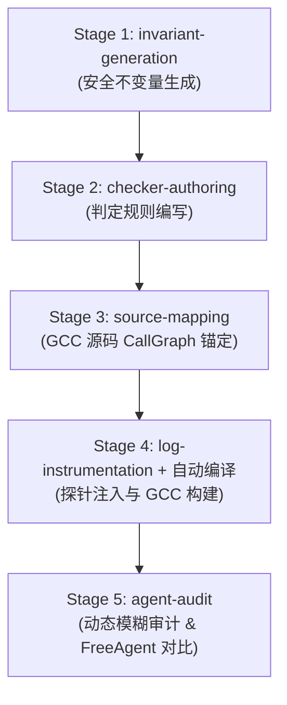

# GCC 16.2 AArch64 实验运行手册与运维指南

本手册记录了本轮针对 **GCC 16.2 AArch64** 编译器安全防御机制的端到端自动化实验详情。包括当前实验的基础配置、运行状态、Token 开销统计、断点恢复（Resume）方法、观测运维手段以及切换不同模型（OpenAI / Anthropic / 本地 vLLM 等）的完整指南。

---

## 1. 本轮实验基本信息

| 维度 | 配置详情 | 说明 |
| :--- | :--- | :--- |
| **目标编译器** | GCC 16.2.0 | 源码根目录位于 `.work/toolchains-matched/gcc-source` |
| **目标架构** | `aarch64` | 显式设置 `--isa aarch64`，严格限定分析 Pass、代码生成与探针范围 |
| **运行模型** | `deepseek/deepseek-flash` | 官方端点 `https://api.deepseek.com`，原生支持 Reasoning，采用晚间低峰期计费 |
| **执行框架** | Pi Runtime (`@earendil-works/pi-coding-agent`) | 配合本地沙箱（macOS `sandbox-exec` / Linux `bwrap`）与 CallGraph MCP |
| **预算设定** | Token 预算 4,000,000，超时时间 120 分钟 | 确保支持端到端 5 个阶段的大规模并发探索 |
| **基准比对源** | `/Users/bytedance/projects/research/defend-reviewer/main` | 包含 43+ 个历史漏洞语料库，通过 `--demo-parity` 自动计算召回与差集 |
| **自动化启动脚本** | `scripts/launch_aarch64_deepseek.sh` | 统一封装环境、参数及日志输出，支持透传参数 |
| **产物输出目录** | `runs/gcc16-aarch64-deepseek/` | 5 个阶段各子目录独立存储 |

### 流水线架构与阶段闭环



---

## 2. 当前进度状态与指标统计

在 18:09 ~ 18:28 运行期间，Stage 1 (`invariant-generation`) 高吞吐稳定推进，各项统计如下：

### 2.1 统计数据汇总

- **运行耗时**：19 分 20 秒
- **模型请求总数**：**232 轮**（100% 成功返回，Exit Code 0）
- **Token 消耗明细**：
  - **总计消耗**：`733,757` Tokens
  - **Prompt 输入**：`592,239` Tokens（语料、历史案例与上下文）
  - **生成输出**：`141,518` Tokens
  - **Reasoning 思考**：`95,177` Tokens
- **候选工件生成**：已产出 **230 个候选单元目录**，全部完好保存在 `runs/gcc16-aarch64-deepseek/invariant-generation/rep-001/artifacts/`。

### 2.2 暂停根因分析

> [!WARNING]
> **中断原因：DeepSeek 平台账户余额耗尽（HTTP 402 Insufficient Balance）**
> - 报错信息：`SubagentRunError: invariant-reviewer: 402: {"message":"Insufficient Balance", ...}`
> - 账户核查：通过 DeepSeek 官方查询接口核查，该 API Key 当前账户余额为 `-0.06 元`（欠费 6 分钱），导致后续请求被上游拒绝。
> - **现场完整性**：所有已评审的 230 个工件、Session 状态和已消耗的 73 万 Token 成果完全冻结保留，无任何数据损坏。

---

## 3. 后续如何继续运行（断点续跑）

本系统完整支持**断点续跑（Resume）**机制。上游充值完成后，无需从头重算已生成的 230 个候选单元。

### 3.1 充值或换 Key

1. 前往 [DeepSeek 开放平台](https://platform.deepseek.com/) 充值 10 ~ 20 元人民币即可充足支持全流程 400 万 Token。
2. 若更换了新的 API Key，可直接更新本地环境文件 `.work/gcc16-aarch64-run/.env`：
   ```bash
   export DEEPSEEK_API_KEY="sk-你的新密钥"
   ```

### 3.2 恢复执行命令

在项目根目录下执行：
```bash
./scripts/launch_aarch64_deepseek.sh --resume
```

### 3.3 自动流转路径

恢复后引擎将执行以下动作：
1. **收尾 Stage 1**：读取现有 230 个候选单元，补全剩余语料分析，输出形式化契约文件 `accepted-invariants.jsonl`；
2. **进入 Stage 2 (`checker-authoring`)**：`checker-author` Worker 在沙箱内为每个契约编写并在本地编译验证 Go Checkers；
3. **进入 Stage 3 (`source-mapping`)**：`source-mapper` 结合 CallGraph MCP 自动将契约精准锚定到 GCC 16 源码；
4. **进入 Stage 4 (`log-instrumentation`)**：生成 `instrumentation.diff` 并**自动调用 Podman 编译出带有动态观测探针的 GCC 交叉编译器**（输出 `toolchains.instrumented.yaml`）；
5. **进入 Stage 5 (`agent-audit`)**：加载探针编译器进行真实编译探测，结合**横向发散思维**深度挖掘绕过 Bug，输出漏洞报告并与 Free Agent 语料库计算 Parity 指标。

---

## 4. 实时观测与运维指南

在实验运行过程中，可通过以下命令实时监控各维度的状态：

### 4.1 查看整体实验日志
```bash
tail -f runs/gcc16-aarch64-deepseek/experiment.log
```

### 4.2 查看实时 Token 消耗统计
```bash
orchestrator/.venv/bin/python -c '
import json
lines = open("runs/gcc16-aarch64-deepseek/invariant-generation/rep-001/token_usage.jsonl").readlines()
records = [json.loads(l) for l in lines]
print(f"总请求数: {len(records)} | 总消耗 Tokens: {sum(r.get(\"total_tokens\", 0) for r in records):,}")
'
```

### 4.3 检查底层交叉编译环境（Podman）
```bash
podman machine list
```
确保虚拟机状态为 `Currently running`，CPU 与内存分配充足（推荐 $\ge 6$ 核, $\ge 8\text{ GB}$ 内存）。

### 4.4 检查各阶段最终产物
| 阶段 | 预期产出文件路径 |
| :--- | :--- |
| **Stage 1** | `runs/gcc16-aarch64-deepseek/invariant-generation/rep-001/artifacts/accepted-invariants.jsonl` |
| **Stage 2** | `runs/gcc16-aarch64-deepseek/checker-authoring/rep-001/artifacts/checkers.jsonl` |
| **Stage 3** | `runs/gcc16-aarch64-deepseek/source-mapping/rep-001/artifacts/source-mappings.jsonl` |
| **Stage 4** | `runs/gcc16-aarch64-deepseek/log-instrumentation/rep-001/artifacts/toolchains.instrumented.yaml` |
| **Stage 5** | `runs/gcc16-aarch64-deepseek/agent-audit/rep-001/artifacts/findings/` 与 `demo-parity.json` |

---

## 5. 如何更换模型（Model Switching Guide）

DeFuzz 体系采用解耦的 Provider 架构，更换模型只需以下三步：

### 方案 A：切换至 DeepSeek 其他模型（如 DeepSeek-V4-Pro / Reasoner）

1. **编辑模型配置** `configs/agents/models.deepseek.json`：
   ```json
   {
     "providers": {
       "deepseek": {
         "baseUrl": "https://api.deepseek.com",
         "api": "openai-completions",
         "apiKey": "${DEEPSEEK_API_KEY}",
         "models": [
           {
             "id": "deepseek-v4-pro",
             "name": "DeepSeek V4 Pro",
             "reasoning": true,
             "input": ["text"],
             "contextWindow": 1000000,
             "maxTokens": 16384
           }
         ]
       }
     }
   }
   ```
2. **更新运行时配置** `.work/gcc16-aarch64-run/pi-runtime.deepseek.json` 中的 `"model_id": "deepseek-v4-pro"`。

---

### 方案 B：切换至 OpenAI / Claude / 兼容网关

以 OpenAI GPT-4o / O1 为例：
1. **新建** `configs/agents/models.openai.json`：
   ```json
   {
     "providers": {
       "openai": {
         "baseUrl": "https://api.openai.com/v1",
         "api": "openai-completions",
         "apiKey": "${OPENAI_API_KEY}",
         "models": [
           {
             "id": "gpt-4o",
             "name": "GPT-4o",
             "reasoning": false,
             "input": ["text"],
             "contextWindow": 128000,
             "maxTokens": 4096
           }
         ]
       }
     }
   }
   ```
2. **新建** `.work/gcc16-aarch64-run/pi-runtime.openai.json`：
   ```json
   {
     "schema_version": 1,
     "model_provider": "openai",
     "model_id": "gpt-4o",
     "models_path": "/Users/bytedance/projects/research/de-fuzz/main/configs/agents/models.openai.json",
     "mcp_path": "/Users/bytedance/projects/research/de-fuzz/main/configs/agents/mcp.example.json",
     "definitions_root": "/Users/bytedance/projects/research/de-fuzz/main/agents/definitions",
     "worker_path": "/Users/bytedance/projects/research/de-fuzz/main/agent-runtime/dist/worker.js",
     "thinking_level": "off",
     "temperature_policy": "apply",
     "max_model_calls": 32,
     "max_output_tokens": 4096,
     "token_budget": 4000000,
     "strict_usage": false,
     "attempt_timeout_seconds": 600,
     "request_timeout_ms": 120000,
     "mcp_startup_timeout_ms": 30000,
     "mcp_call_timeout_ms": 30000,
     "cleanup_timeout_ms": 5000,
     "credential_env": ["OPENAI_API_KEY"]
   }
   ```
3. **设置环境变量并启动**：
   ```bash
   export OPENAI_API_KEY="sk-..."
   ./orchestrator/.venv/bin/python -m defuzz_loop.experiments_cli run-all \
     --output-root runs/gcc16-aarch64-openai \
     --pi-config .work/gcc16-aarch64-run/pi-runtime.openai.json \
     --source-root .work/toolchains-matched/gcc-source \
     --target-tree .work/toolchains-matched/gcc-source \
     --toolchains-config .work/gcc16-aarch64-run/toolchains.host.yaml \
     --corpus-root .work/gcc16-security-corpus \
     --checker-source-root . \
     --backend pi \
     --isa aarch64 \
     --demo-parity \
     --token-budget 4000000 \
     --time-budget-minutes 120
   ```

---

### 方案 C：切换至本地私有模型（vLLM / SGLang / Ollama）

1. 启动本地 OpenAI 兼容服务（例如 vLLM 监听在 `http://127.0.0.1:8000/v1`）。
2. 在 `models.local.json` 中配置：
   ```json
   {
     "providers": {
       "local": {
         "baseUrl": "http://127.0.0.1:8000/v1",
         "api": "openai-completions",
         "apiKey": "none",
         "models": [
           {
             "id": "qwen2.5-coder-32b",
             "name": "Qwen 2.5 Coder 32B",
             "reasoning": false,
             "input": ["text"],
             "contextWindow": 65536,
             "maxTokens": 8192
           }
         ]
       }
     }
   }
   ```
3. 对应的 `pi-runtime.local.json` 中设置 `"credential_env": []`，指定 `"model_provider": "local"` 和 `"model_id": "qwen2.5-coder-32b"` 即可实现完全离线本地运行。

---

## 6. 验证与预检（Preflight）

无论更换哪种模型或配置，在正式启动耗时实验前，建议执行如下预检：

1. **配置语义检查**：
   ```bash
   orchestrator/.venv/bin/python -c '
   from pathlib import Path
   from defuzz_loop.experiment_engine.pi_backend import PiAgentBackend
   backend = PiAgentBackend(Path(".work/gcc16-aarch64-run/pi-runtime.deepseek.json"))
   backend.preflight(require_isolation=True)
   print("Preflight passed successfully!")
   '
   ```
2. **五阶段流转规划预检（不产生真实模型调用）**：
   ```bash
   ./scripts/launch_aarch64_deepseek.sh --show-plan
   ```
   若输出完整 JSON Plan 并以 Exit 0 结束，即代表该配置完全具备端到端执行条件。
